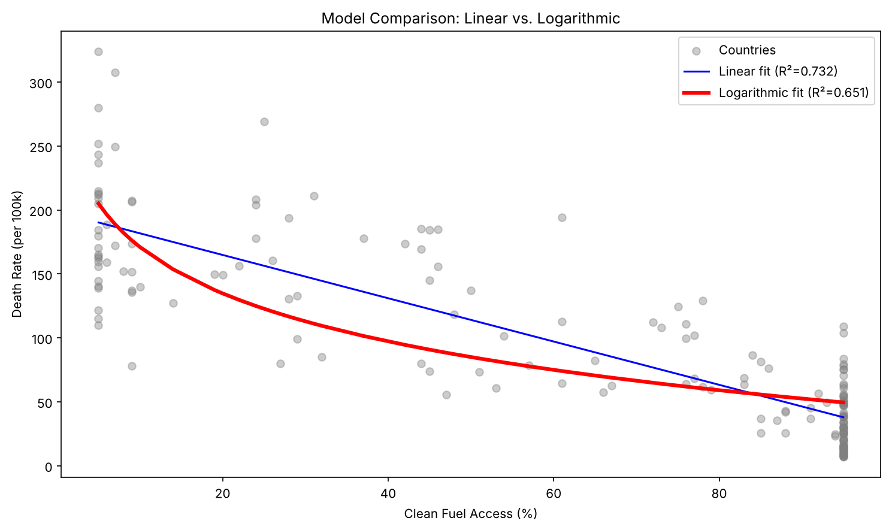
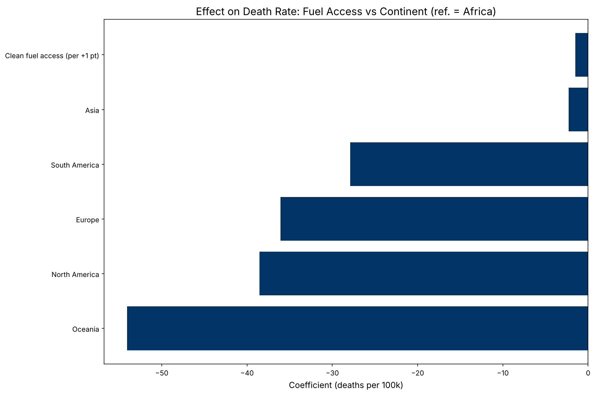

# Clean Fuel, Cleaner Air, Fewer Deaths

## Project Description

Cross-sectional regression analysis of WHO data for 179 countries (2016), estimating the relationship between clean cooking-fuel access and age-standardized air-pollution mortality. Each percentage point of access is associated with 1.69 fewer deaths per 100k (R² = 0.73, p < 0.001). Adding continent fixed effects raises R² to 0.79.

Stack: Python (pandas, statsmodels, seaborn), SQL

## Process

| Step | Process |
|---|---|
| Merged | Joined two [WHO datasets](https://www.kaggle.com/datasets/utkarshxy/who-worldhealth-statistics-2020-complete) on country-year keys in [pandas](src/01_merge_data.py) and [SQL](merge_tables.sql). Mapped countries to continents for regional controls. |
| Parsed | Extracted point estimates from WHO string values with confidence intervals, e.g. `"95.12 [85.12-104.3]"`. |
| Deduplicated | Found the mortality table stored 36 rows per country (2 measures × 3 sexes × 6 causes). Kept one age-standardized, both-sex, all-cause row per country. R² rose from 0.14 to 0.73. |
| Explored | Compared mortality distributions by continent. Africa's median (162 per 100k) is 7× Europe's (24). |
| Modeled | Fit OLS with linear and log-transformed predictors, then a multiple regression with continent dummies. Compared models on R² and AIC. |

## Models

| Model | R² | AIC | Fuel coefficient |
|---|---|---|---|
| Linear | 0.73 | 1809 | −1.69 per point |
| Log-linear | 0.65 | 1856 | −56.1 per log unit |
| Linear + continent fixed effects (best) | 0.79 | 1775 | −1.50 per point |

All fuel coefficients are significant at p < 0.001.

## Findings

- Rejected the null of no association between fuel access and mortality.
- The log specification fit worse (ΔAIC = +47), so there is no evidence of diminishing returns. The effect is roughly linear across the access range.
- With continent fixed effects, the fuel coefficient shrinks only from −1.69 to −1.50 and stays the dominant predictor. Oceania, the Americas and Europe have significantly lower mortality than Africa at the same access level.
- Getting the data to one row per country mattered more than model choice. Removing duplicate rows changed which specification won.

## Limitations

- Single-year cross-section, so the results are associational, not causal.
- WHO censors access values at 5% and 95%.
- Omitted variables include income and ambient (outdoor) pollution.

## Run It

    pip install -r requirements.txt
    python run_all.py

Outputs figures to `figures/` and regression summaries to `.txt` files in the main folder.
