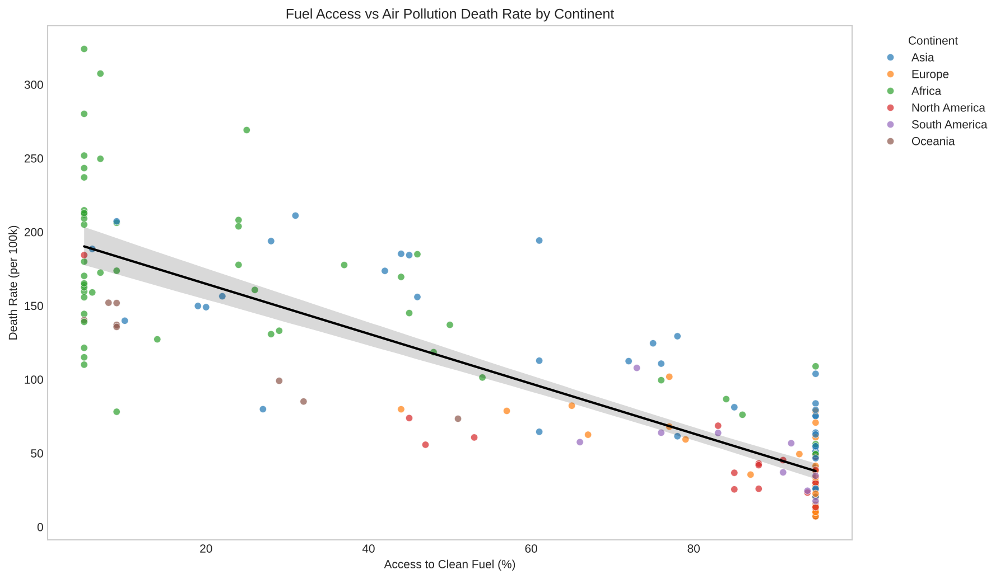

# Clean Fuel, Cleaner Air, Fewer Deaths

Measured how clean cooking fuel affects air-pollution deaths across **179 countries** using WHO data.

**Result:** Each extra point of clean-fuel access goes with **1.7 fewer deaths per 100k**. Fuel access alone explains **73%** of the gap between countries.

`Python` · `pandas` · `statsmodels` · `seaborn` · `SQL`



## Process

| Step | What I did |
|---|---|
| **Defined** | Asked how a country's clean-fuel access relates to its air-pollution death rate. |
| **Merged** | Joined two [WHO datasets](https://www.kaggle.com/datasets/utkarshxy/who-worldhealth-statistics-2020-complete) on country + year in [Python](src/01_merge_data.py) and [SQL](merge_tables.sql). Mapped each country to a continent. |
| **Parsed** | Extracted numbers from WHO text values like `"95.12 [85.12-104.3]"`. |
| **Deduplicated** | Found 36 rows per country (2 measures × 3 sexes × 6 causes). Kept one age-standardized total per country. Raised R² from 0.14 to 0.73. |
| **Explored** | Compared death rates by continent. Africa's median (162) is 7× Europe's (24). |
| **Modeled** | Tested linear, logarithmic and multiple regression. |

## Models

| Model | R² | AIC | Fuel effect |
|---|---|---|---|
| Linear | 0.73 | 1809 | −1.69 per point |
| Logarithmic | 0.65 | 1856 | −56.1 per log unit |
| **Linear + continent** | **0.79** | **1775** | −1.50 per point |

All fuel effects are significant (p < 0.001).


## Findings

**Rejected the null.** Higher clean-fuel access means significantly lower mortality.

**Ruled out diminishing returns.** The log model fit worse. Gains hold at every level of access.

**Controlled for region.** Fuel stays the strongest driver. Oceania, the Americas and Europe still show lower death rates than Africa at the same access level.


**Key lesson:** Checking the data's structure mattered more than model choice. Removing duplicate rows changed which model won.

**Limits:** One year (2016), correlation only. WHO caps access at 5% and 95%. Income and outdoor pollution not modeled.

## Run it

```bash
git clone https://github.com/<your-username>/<repo-name>.git
cd <repo-name>
pip install -r requirements.txt
python run_all.py
```

Outputs charts to `figures/` and regression summaries to `.txt` files in the main folder.
